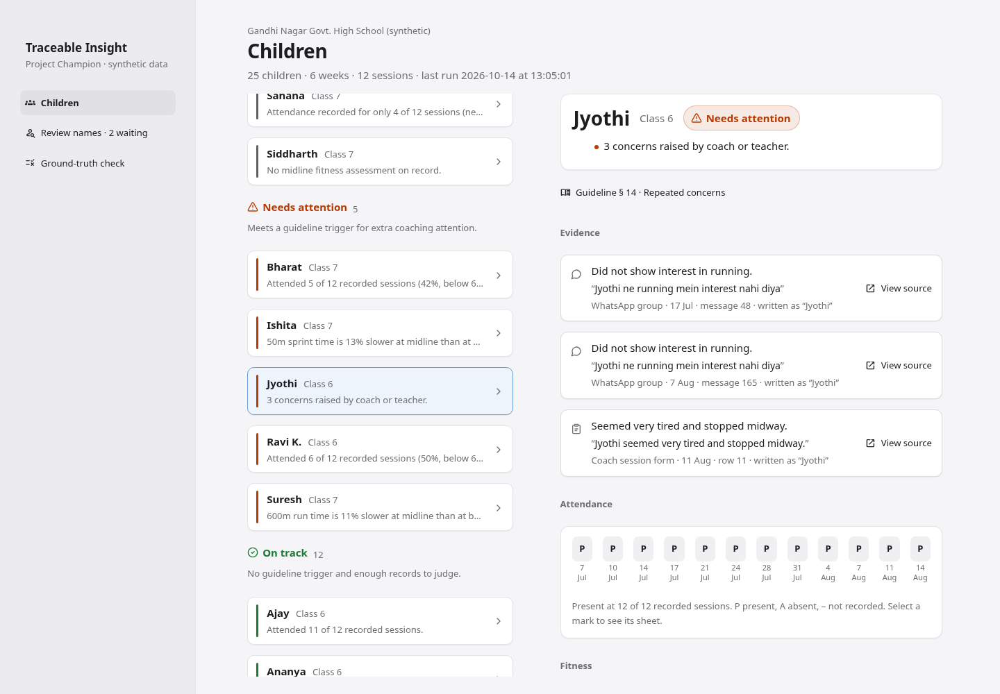

# Traceable Insight

**Problem 09B · Team HFMD Aur Samose · Hyderabad Runners Society, Project Champion**

Turns scattered evidence about each child (WhatsApp chat, attendance sheets, coach session
forms, fitness assessments, the programme guideline) into cited facts, and places each child in
exactly one state:

| State | Rule (synthetic thresholds, `data/synthetic/programme/thresholds.yaml`) |
|---|---|
| **Conflict to review** | The coach form says the child took part on a day the attendance sheet marks them absent |
| **Not enough information** | Fewer than 6 of 12 sessions recorded, or no midline assessment |
| **Needs attention** | Attendance below 60%, a sprint or 600m time more than 8% slower, or 2+ concerns |
| **On track** | None of the above |

Precedence runs top to bottom. The tool flags and cites; the coordinator decides. There are no
scores or rankings of children, the data is synthetic, and there are no new forms for coaches.

## Quick start

```bash
uv sync
ollama serve &                 # local model; nothing leaves the machine
ollama pull qwen3:4b           # or set TI_OLLAMA_MODEL
uv run python run_pipeline.py --school school_a      # ingest → extract → link → state + check
uv run streamlit run app/coordinator.py              # coordinator view on localhost:8501
```

Optional:

```bash
uv run python -m ti.generator --school school_a --seed 42   # regenerate the synthetic school
uv run python -m ti.score --school school_a                 # ground-truth check only
uv run uvicorn ti.api:app                                    # thin JSON API (A7)
uv run pytest                                                # tests (ollama-marked test skips if down)
```

## Current baseline (School A, seed 42, qwen3:4b)

| Target | Result |
|---|---|
| Name mentions linked to the right child (≥ 85%) | 99.7% of 320 (99.1% on an earlier cold run) |
| Planted conflicts found (≥ 3 of 4) | 4 of 4 |
| Planted gaps found (≥ 3 of 4) | 4 of 4 |
| Cited facts that open their source line (100%) | 100% of 457 |
| Children in their planted state | 25 of 25 |

A cold run takes about 2.5 minutes on an RTX 4050; cached re-runs take under a second. Ollama
on a GPU is not perfectly deterministic even at temperature 0, so link accuracy moves by a few
mentions between cold runs. Model answers are cached in `var/llm_cache` so the demo is stable.
The misses are the model failing to pull a name out of a Hinglish message. A bare "ravi" goes
to the review queue on purpose, because two children share the name.



## How it works

```
A1 generator ─► data/synthetic/school_a/*  (+ ground_truth.json, read only by ti.score)
                   │
A2 ingest ── parse every source, scrub phone numbers / links / media
A3 extract ─ rule facts from sheets; Ollama facts from chat + coach notes
             every quote must be an exact substring of its source line, or it is dropped
A4 link ──── rapidfuzz + jellyfish against the roster; unclear names → review queue
A5 store ─── SQLite at var/<school>.db (git-ignored)
A6 state ─── four rules, one state per child, with evidence fact ids + guideline section
A7 API ───── FastAPI over ti.queries
A8 view ──── Streamlit: children by state, cited facts, source viewer, review queue, check
```

| Path | Component |
|---|---|
| `src/ti/generator/` | A1 synthetic data generator (seeded) |
| `src/ti/ingest/` | A2 parsers and PII scrub |
| `src/ti/extract/` | A3 fact extraction and span verification |
| `src/ti/link/` | A4 name matcher |
| `src/ti/store/` | A5 schema and thresholds |
| `src/ti/state/` | A6 state rules |
| `src/ti/api/`, `src/ti/queries.py` | A7 API and shared read layer |
| `app/` | A8 coordinator view |
| `run_pipeline.py`, `src/ti/score.py` | #14 one-command run, #15 scoring |

## Privacy

- Synthetic by design: fictional school, randomly combined names, phone numbers from a fake
  reserved range.
- Scrubbed at ingest: phone numbers, links and media never reach the store.
- Local only: extraction runs on an open-weight model through Ollama. The Streamlit server binds
  to localhost.
- Minimal display: first name, class, state and cited facts.
- `var/` and `data/private/` are git-ignored.

## Known limitations

- The same kind of local model writes the Hinglish chat and later reads it, which can flatter
  accuracy. Sprint 3 adds hand-written messages.
- Thresholds are placeholders until HRS validates them.
- One conflict rule only (coach form vs. attendance). Full conflict detection and an NLI check on
  citations come in Sprint 3.
